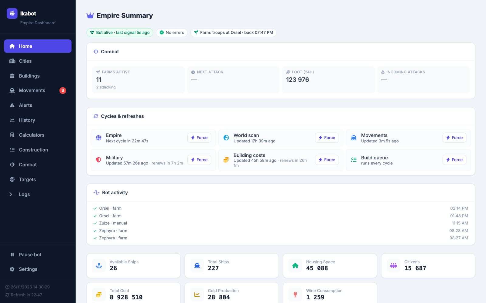
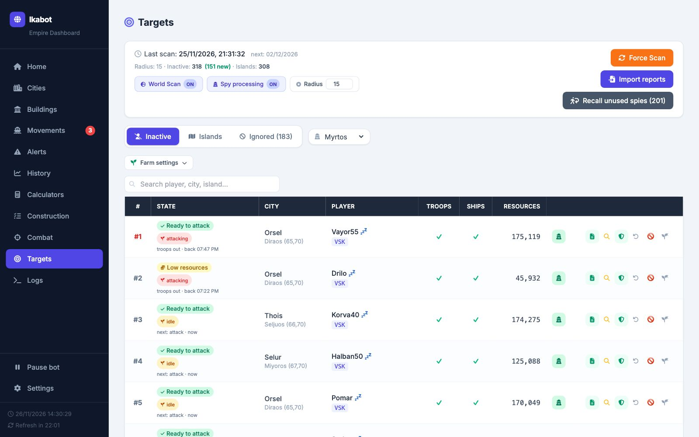
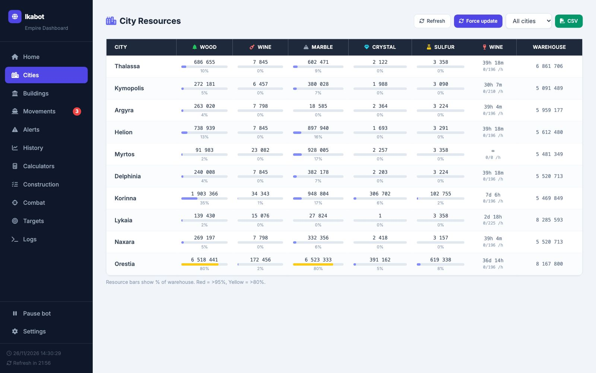
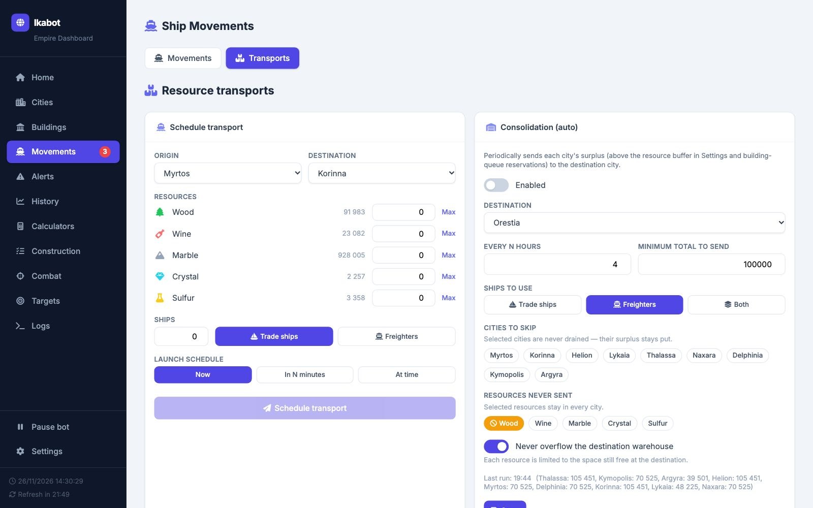
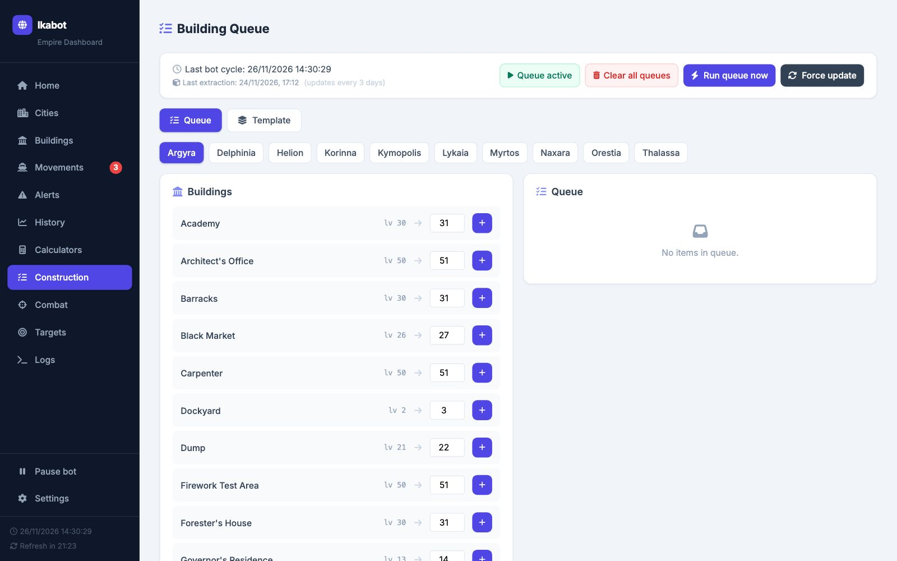
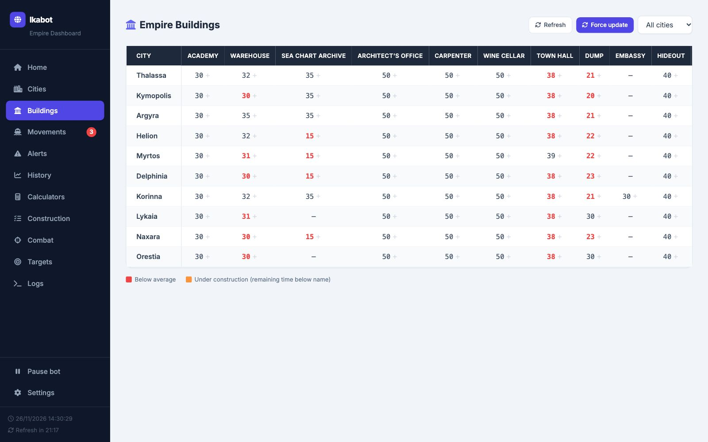

# Ikabot Dashboard

[](https://github.com/luismiguelopes/ikabot-dashboard/actions/workflows/ci.yml)
[](https://github.com/luismiguelopes/ikabot-dashboard/releases/latest)
[](LICENSE)


A web dashboard and a set of automation modules for [ikabot](https://github.com/ikabot-collective/ikabot),
the bot for the browser game Ikariam. It runs in Docker next to the bot and shows the whole
empire on one page: resources, buildings, fleet movements, a building queue with automatic
resource transports, wine logistics, espionage and an automated farm of inactive targets.

> [!NOTE]
> Screenshots use **fictional data**: city, player, island and alliance names are replaced,
> coordinates are shifted, every quantity is scaled by a random factor and only some of the
> cities are shown. See [tools/screenshots](tools/screenshots/README.md).

## Screenshots



| | |
|---|---|
|  |  |
| **Targets**: inactive players near your cities and the automated farm, with each target's state and next action | **Cities**: resources, warehouse fill and wine runway for every city |
|  |  |
| **Transports**: scheduled transports and automatic consolidation of surplus | **Building queue**: per-city upgrade queue that sends the missing resources on its own |
|  | |
| **Buildings**: every building level in every city, below-average ones highlighted | |

## Features

- **Empire at a glance**: gold, ships, citizens, production and wine consumption; per-city
  resources and building levels; live fleet movements with countdowns; 7- and 30-day history charts.
- **Live updates**: the page refreshes itself (Server-Sent Events) within seconds of the bot
  writing new data.
- **Building queue**: queue upgrades per city or apply a template to all cities. When a city
  lacks resources, the bot ships them from the cities with surplus.
- **Transports and wine**: scheduled transports, automatic consolidation of surplus to one city,
  a wine balancer that rescues cities running dry, and an optional wine buyer on the market with
  hard limits (price ceiling, gold floor, spend cap, dry run).
- **World scan and targets**: finds inactive players near your cities, ranks them, and keeps
  notes, marks and spy reports per player.
- **Espionage**: spy dispatch, warehouse/garrison/movement reports, recall of idle spies, and
  training of new spies to fill free slots.
- **Automated farm**: a state machine per target (idle → spying → attacking) timed to the real
  round trip. A target is only raided after a complete live scout, so troops are never sent
  against a fleet that was out at sea.
- **Calculators**: building upgrade time, sawmill/quarry ROI and colony ROI.
- **Notifications**: Telegram and Discord, with levels, muted categories and a daily digest.
- **Safety**: random delays before every game request, a single active-hours window, a global
  pause button and optional password protection for the dashboard.
- **Robustness**: digest-pinned bot image, persistent login session, healthcheck with
  auto-restart, daily SQLite backups and ~700 tests that need no game connection.
- **English and Portuguese** interface.

> [!IMPORTANT]
> Automating a browser game may go against its terms of service. Use this project at your
> own risk, on your own account.

## Quick start

Requirements: Docker with Docker Compose, Node.js (to build the dashboard) and an Ikariam account.

1. Clone this repository.
2. Create a `.env` file in the project root (never commit this file):

```env
IKABOT_EMAIL=your_email@example.com
IKABOT_PASSWORD=your_password

# Optional — shown with defaults
EMPIRE_UPDATE_INTERVAL=1h
BUILDING_COSTS_UPDATE_INTERVAL=3d
WORLD_SCAN_UPDATE_INTERVAL=7d
WORLD_SCAN_RADIUS=10
QUEUE_ACTIVE_HOURS=8-23
SCAN_ACTIVE_HOURS=8-23
SCAN_NIGHT_INTERVAL=4h
LOG_LANG=en
# Optional: require a login for the dashboard's action routes
DASHBOARD_PASSWORD=choose-a-password
```

3. Build the dashboard and start the containers:

```bash
(cd frontend && npm ci && npm run build)
docker compose up -d
```

4. Open the dashboard at [http://localhost:5001](http://localhost:5001).

## Configuration

Duration variables accept `Nd` (days), `Nh` (hours), `Nm` (minutes), `Ns` (seconds), or a plain integer (seconds).

| Variable | Default | Description |
|---|---|---|
| `IKABOT_EMAIL` | — | Ikariam account email |
| `IKABOT_PASSWORD` | — | Ikariam account password |
| `DASHBOARD_PASSWORD` | *(unset)* | If set, the dashboard requires this password to log in (protects every `/api/*` action route). Unset = open dashboard. |
| `BOT_OFFLINE_SECS` | `1800` | Single source for "bot offline": healthcheck, autoheal, Telegram watchdog and the sidebar badge |
| `EMPIRE_UPDATE_INTERVAL` | `1h` | Interval between full empire data cycles (within active scan hours) |
| `BUILDING_COSTS_UPDATE_INTERVAL` | `3d` | Interval between building cost refreshes |
| `WORLD_SCAN_UPDATE_INTERVAL` | `7d` | Interval between world scans |
| `WORLD_SCAN_RADIUS` | `10` | Max tile distance from own cities included in the world scan |
| `QUEUE_ACTIVE_HOURS` | *(all hours)* | Hours during which the queue may **start constructions and dispatch transports** — format `H-H`, e.g. `8-23` |
| `SCAN_ACTIVE_HOURS` | *(all hours)* | Hours during which the bot runs **full empire scans** at the normal interval. Outside this window it scans at `SCAN_NIGHT_INTERVAL` instead. Format `H-H`, e.g. `8-23`. Unset = 24h operation |
| `SCAN_NIGHT_INTERVAL` | `4h` | Scan frequency outside `SCAN_ACTIVE_HOURS`. Keeps data roughly fresh overnight without hourly HTTP activity |
| `WINE_CRITICAL_NOTIFY_HOURS` | `2h` | Wine-critical Telegram alert threshold in hours |
| `LOG_LANG` | `en` | Backend log language (`en` or `pt`) |


## Dashboard pages

| Page | What it shows |
|---|---|
| **Home** | Bot health, combat summary, data cycles with "force" buttons, recent activity and empire totals |
| **Cities** | Resources, warehouse fill, production and wine runway per city; CSV export |
| **Buildings** | Building levels per city, below-average levels and constructions in progress |
| **Movements** | Fleet and army movements with countdowns; the **Transports** tab schedules transports and sets up consolidation and wine logistics |
| **Alerts** | Wine running out, storage overflow, negative gold, failing transports and subsystems |
| **History** | Gold, resources, ships and citizens over time, for the empire or one city |
| **Calculators** | Building upgrade time, sawmill/quarry ROI, colony ROI |
| **Construction** | Building queue per city and building templates |
| **Combat** | Manual attack dispatch (pillage or naval attack, now or scheduled) and attack history |
| **Targets** | World scan of inactive players and islands, spy reports and the automated farm |
| **Logs** | Tail of the bot log |
| **Settings** | Language, alerts, construction, espionage, spy training and notifications |

## How it works

```
 ┌───────────────┐   HTTP (random delays)   ┌──────────────┐
 │    ikabot     │ ───────────────────────▶ │ Ikariam game │
 │ + bot/ modules│                          └──────────────┘
 └──────┬────────┘
        │ writes                 shared volume /tmp/ikalogs
        ▼                        (SQLite ikabot.db + JSON files)
 ┌───────────────┐   reads / queues actions  ┌──────────────────────┐
 │ ikabot.db     │ ◀──────────────────────── │ ikabot-gui (Flask)   │ ◀── browser :5001
 │ + JSON files  │                           │ REST API + SSE + SPA │
 └───────────────┘                           └──────────────────────┘
```

The bot runs one main loop: a full empire update, then the building queue, transports,
espionage, the farm and the world scan, then sleeps until the next event (a construction
finishing, a fleet arriving, the next cycle). Only the bot talks to the game. The dashboard
reads the shared database and queues actions there for the bot to pick up.

Details (main loop, API endpoints, the espionage and farm pipeline, data storage, patches to
the stock ikabot code) are in **[docs/ARCHITECTURE.md](docs/ARCHITECTURE.md)**.

## Docker commands

```bash
docker compose up -d                          # start all containers
docker compose logs -f ikabot                 # follow the bot log
docker compose up -d --force-recreate ikabot  # apply changes to a bot module
(cd frontend && npm run build)                # rebuild the dashboard, then refresh the browser
docker compose down                           # stop everything
```

The modules in `bot/` are mounted into the containers, so no image rebuild is needed when you
edit them, but Python caches modules: after changing a `.py` file, recreate the `ikabot` and
restart `ikabot-gui`.

## Project Structure

```
.
├── docker-compose.yml
├── bot/                     # Custom bot modules — bind-mounted into the ikabot container
│   ├── bot_launcher.py      # Deterministic startup: login, launch empireFunction by reference, inject surgical patches, keep the menu on PID1
│   ├── empireFunction.py    # Main loop orchestrator: full cycle → queue → espionage → farm → scans → smart_sleep
│   ├── empire_utils.py      # Config/env, logger + i18n (lm), ThrottledSession, with_retry, is_paused, config validation, downtime accounting
│   ├── empire_collector.py  # City data collection, movements fetch, military (troops + fleet) every 8h
│   ├── costs_collector.py   # Building costs collection (every 3 days)
│   ├── scan_collector.py    # Incremental world scan (shallow quadrants + deep per-island checkpoint)
│   ├── queue_processor.py   # Building queue, resource transports, smart_sleep (processes spy/recall/attack/farm/scan queues)
│   ├── farm_manager.py      # Automated farming (F4): per-target state machine, ship reserve, drain loop (F13)
│   ├── espionage_manager.py # Spy state machine, recalls, report parsing, spy-count fetch, mission retention
│   ├── espionage_parsers.py # Pure HTML parsers extracted from espionage_manager
│   ├── attack_manager.py    # Attack queue + senders (plunder/blockade/deploy) and shared targeting helpers
│   ├── transport_manager.py # Scheduled transports, consolidation, wine balancer (F9), wine market buyer (F10)
│   ├── db_manager.py        # SQLite layer: schema init, CRUD, migrations, shared_queue, daily online backup
│   ├── planroutes_overrides.py       # Surgical runtime patch for planRoutes (anti-detection delays) — injected, not shadowed
│   ├── loadcustommodule_overrides.py # Surgical runtime patch for loadCustomModule
│   ├── telegram_notifier.py # Telegram Bot API notifications
│   └── healthcheck.py       # Freeze-aware heartbeat healthcheck (used by compose + autoheal)
├── tools/screenshots/       # Takes the README screenshots with fictional data
├── tests/                   # pytest — ~700 tests (db, queues, parsers, spy state machine,
│                            #   farm/respy/reserve/loot, attack payload golden-files, wine, throttle, health, downtime, Flask API)
├── ikabot_gui/
│   └── app.py               # Flask REST API + SSE stream + serves frontend/dist
├── frontend/
│   ├── src/
│   │   ├── App.tsx          # Root: SSE EventSource, routing, LangContext, global pause/attack banners
│   │   ├── components/      # One file per page/feature (HomePage, CitiesPage, BuildingsPage, Construction,
│   │   │                    #   MovementsPage, TransportTab, CombatPage, DispatchTab, WinePanorama, Logs, Settings, AuthGate, mundo/)
│   │   ├── types.ts · i18n.tsx · utils.ts · constants.ts · hooks/
│   ├── vite.config.ts       # Dev proxy /api/* → Flask (production build served by Flask)
│   └── package.json
└── .env                     # Credentials — never commit this
```


## Running tests

```bash
python -m venv .venv && .venv/bin/pip install -r requirements-dev.txt
.venv/bin/python -m pytest tests/ -q
```

Tests use temporary SQLite databases and stub the ikabot imports, so no game session is needed.
Some tests also need the upstream ikabot source in `./ikabot`: see
[CONTRIBUTING.md](CONTRIBUTING.md#before-opening-a-pr) for the exact version CI uses.

## Versions and releases

`main` always holds the latest merged work; it is tested by CI but may change several times a
day. **Releases** are tags on `main` that have run well in production for a while — use the
[latest release](https://github.com/luismiguelopes/ikabot-dashboard/releases/latest) if you
want a stable setup:

```bash
git fetch --tags
git checkout v1.0.0          # the release you want
docker compose up -d --force-recreate
cd frontend && npm ci && npm run build
```

Versions follow `MAJOR.MINOR.PATCH`:

- **PATCH** (`v1.0.1`): bug fixes only.
- **MINOR** (`v1.1.0`): new features; nothing to change when updating.
- **MAJOR** (`v2.0.0`): updating needs action on your side (a new required `.env` setting, a
  data migration, …) — the release notes say what.

The dashboard shows the version it was built from under **Settings → General**. Please include
it in bug reports.

After every merge to `main`, [Release Drafter](https://github.com/release-drafter/release-drafter)
updates a **draft** of the next release: its notes list the merged pull requests grouped by
label, and its version number follows from those labels (`breaking` → major, `enhancement` →
minor, anything else → patch). The maintainer publishes the draft when `main` has proven stable.
PRs labelled `skip-changelog` are left out. See `.github/release-drafter.yml`.


## Contributing

Contributions are welcome: see [CONTRIBUTING.md](CONTRIBUTING.md). Issues, pull requests and
commit messages are in English.

## License

[MIT](LICENSE).
